<div align="center">

# SO-101 Studio

**카메라 없이 초음파 센서 두 개로 물체를 찾아 집어 옮기는 SO-101 로봇팔 제어 프로그램**

*Pick-and-place for the SO-101 arm using two low-cost ultrasonic sensors instead of a camera — web GUI, kinematic and MuJoCo physics simulators, ACT imitation learning. Windows, Python 3.12. Docs in Korean.*

-orange)


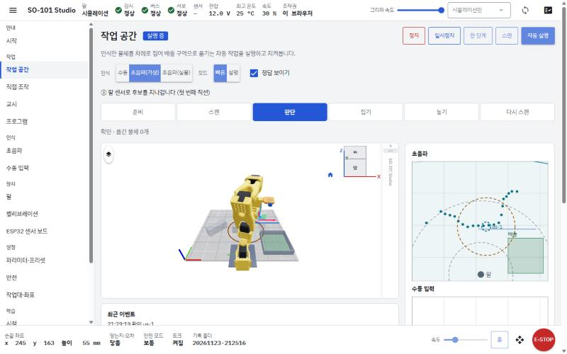

</div>

> **지금 상태 (2026-11-23)**: 시뮬레이션에서는 인식부터 집어 옮기기까지 처음부터 끝까지 돈다. 실물 팔로는 집기·놓기 왕복까지 확인했고, 실물 초음파 레이더는 조립 뒤 실측·보정할 차례다. 아래 숫자는 모두 시뮬레이션 값이다.

## 목차
1. [무엇을 하는 프로그램인가](#1-무엇을-하는-프로그램인가)
2. [설치와 실행](#2-설치와-실행)
3. [처음 10분 따라 하기](#3-처음-10분-따라-하기)
4. [화면 공통 구성](#4-화면-공통-구성)
5. [페이지별 사용법](#5-페이지별-사용법)
6. [시뮬레이션 두 가지와 다른 기기에서 보기](#6-시뮬레이션-두-가지와-다른-기기에서-보기)
7. [명령줄](#7-명령줄)
8. [안전 수칙](#8-안전-수칙)
9. [실물 팔 연결](#9-실물-팔-연결)
10. [하드웨어](#10-하드웨어)
11. [구조와 폴더](#11-구조와-폴더)
12. [문제 해결](#12-문제-해결)
13. [알려진 한계](#13-알려진-한계)
14. [감사와 라이선스](#14-감사와-라이선스)

---

## 1. 무엇을 하는 프로그램인가
작업대 앞에 서보로 도는 **초음파 레이더**(HC-SR04)가 있고, 팔 손목에 **초음파 센서**가 하나 더 붙어 있다.

1. **스캔**: 레이더가 좌우로 돌며 각도마다 거리를 재서 물체 후보를 찾는다.
2. **판단**: 후보를 팔에서 가까운 순서로 고른다.
3. **확인**: 팔이 손목 센서를 후보 위로 지나가게 해서 위치·폭·방향을 좁힌다(`CHECK`).
4. **집기 → 놓기**: 물체 방향에 맞춰 쥐고 배출 통에 내려놓는다.
5. **다시 스캔**: 다음 물체로. 후보가 없으면 레이더를 다시 돌린다(`RESCAN`).

같은 작업을 사람이 좌표를 알려 주는 **수동 입력**, 카메라 방식과 비교해 초음파가 유리한 환경을 찾는 것이 목표다. 팔은 브라우저 GUI로 조작하고 지켜본다.

### 결과 (시뮬레이션, 2026-11-23)
| 실험 | 결과 |
|---|---|
| 초음파 인식으로 집어 옮기기, 시연 배치(물체 3개), 낙관 / 비관 센서 모델 | **96% / 92%** (정답 좌표로는 100%) |
| 집기 성공: 규칙 기반 / ACT 모방학습 (같은 배치 200개) | **199 / 168** |
| ACT, 학습에 쓰지 않은 새 배치 50개 | 37/50 (74%) |
| 실물 팔 집기·놓기 왕복 (58mm 상자, 속도 30%·50%) | 10/10 |

실험 방법: [`docs/planning/comparison-experiment.md`](docs/planning/comparison-experiment.md)

---

## 2. 설치와 실행
### 필요한 것
- Windows 10/11, 디스크 약 3GB (처음 설치 때 받는 양)
- 인터넷 (설치할 때만)
- 실물 팔은 선택이다. 없으면 시뮬레이션으로 켜진다.

### 설치
1. 레포를 받는다.
   ```powershell
   git clone https://github.com/donghyeon04/SO-101-Studio
   ```
   git이 없으면 GitHub의 **Code → Download ZIP**을 풀어도 된다(이 경우 켤 때 자동 업데이트가 없다).
2. **`설치.cmd`** 를 더블클릭한다.
   - conda가 없으면 Miniforge를 `C:\so101-tools\miniforge3`에 설치한다(관리자 권한 필요 없음).
   - `so101` 환경을 만들고 점검(`doctor`) 결과를 보여 준다.
   - **MuJoCo(물리 시뮬레이션)** 를 설치할지 `Y/n`으로 묻는다.
   - 바탕화면과 시작 메뉴에 **"SO-101 Studio"** 바로가기를 만든다.

### 실행
바탕화면의 **"SO-101 Studio"** 를 더블클릭하면 브라우저에 `http://127.0.0.1:8080`이 열린다.
- 켤 때마다 `git pull`로 최신 버전을 받는다(실패해도 지금 버전으로 켜진다).
- 팔이 USB에 꽂혀 있으면 실물로, 없으면 시뮬레이션으로 켜진다. 어느 쪽인지 시작 화면 맨 위에 크게 나온다.

### 지우기
`제거.cmd`를 실행한다. 지울 목록을 보여 주고 `yes`를 입력해야 진행한다. `so101` 환경과 바로가기를 지우고, 레포 폴더(기록 `runs/` 포함)는 남긴다.

---

## 3. 처음 10분 따라 하기
시뮬레이션에서 그대로 따라 할 수 있다. 시작 화면의 "처음이면 이 순서로" 버튼 세 개가 같은 순서다.

| 순서 | 어디서 | 무엇을 | 보이는 것 |
|---|---|---|---|
| 1 | **직접 조작** | 오른쪽 "조그"에서 관절 버튼을 누르거나, 3D 작업대를 클릭해 점을 찍고 **[이동]** | 3D의 노란 팔이 움직인다. 보라색 반투명 팔은 "가려는 자세" 미리보기 |
| 2 | **교시** | "기록"에서 저장된 동작(예: `wave`)을 고르고 **[재생]** | 기록한 동작을 그대로 따라 한다 |
| 3 | **작업 공간** | 인식 **[수동]** 그대로 **[자동 실행]** | 준비 → 스캔 → 판단 → 집기 → 놓기 칸이 차례로 켜지며 물체 3개를 배출 통에 옮긴다 |
| 4 | **작업 공간** | 인식을 **[초음파(가상)]** 으로 바꾸고 **[자동 실행]** | 가상 레이더가 돌고, 팔이 손목 센서로 후보를 확인한 뒤 집는다. 오른쪽 초음파 평면에 점과 원이 그려진다 |
| 5 | **초음파** | 방금 실행의 기록 보기 | 레이더 원자료 → 후보 → 확인 → 최종 위치가 단계별로 겹쳐 보인다 |

> 언제든 오른쪽 아래 빨간 **E-STOP** 또는 키보드 **F9** 로 멈춘다.

---

## 4. 화면 공통 구성
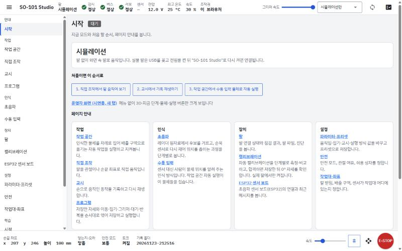

| 영역 | 위치 | 내용과 조작 |
|---|---|---|
| **상단 상태줄** | 맨 위 | 팔(시뮬레이션/실물), 감시·버스·서보 상태(정상/주의/오류), 센서, 전압, 최고 온도, 속도, 조작권. 오른쪽에 **그리퍼 속도** 막대, **실행 방식** 고르기, **다시 연결**, **점검** 아이콘 |
| **사이드바** | 왼쪽 | 페이지 17개를 안내·작업·인식·장치·설정·학습·시스템 묶음으로. 왼쪽 위 ☰ 로 접는다 |
| **페이지 머리** | 각 페이지 위 | 제목, 상태 배지(대기/실행 중/정지/오류), 한 줄 설명, 오른쪽에 그 페이지의 주요 버튼 |
| **아래 조작 막대** | 맨 아래 | 손끝 좌표(x·y·높이), 닿는지·오차, 안전 모드, 토크, 기록 폴더. 오른쪽에 **속도** 막대(%), **[홈]**, **조그 패널** 열기(✥), **E-STOP** |
| **조그 패널** | ✥ 를 누르면 오른쪽 서랍 | 어느 페이지에서나 관절·직교 조그와 그리퍼 열기/닫기 |
| **3D 보기** | 3D가 있는 페이지 | 마우스로 돌리기·확대. 오른쪽 위 **뷰 큐브**의 면을 누르면 그 방향에서 본다. 집 아이콘 = 처음 시점. 왼쪽 위 겹 버튼으로 보일 것(계산 자세, 물체, 인식 흐름 등)을 고른다 |

### 실행 방식 (상단 오른쪽)
| 방식 | 뜻 |
|---|---|
| 시뮬레이션만 | 3D의 가상 팔만 움직인다 (팔이 없을 때 기본) |
| 실제만 | 실물 팔만 움직인다 |
| 동시 | 가상 팔과 실물 팔이 함께 움직인다 |
| 시뮬레이션 먼저 | 가상 팔로 먼저 돌려 보여 준 뒤, 확인 창에서 **[실물에서 실행]** 을 눌러야 실물이 움직인다 |

### 조작권과 E-STOP
- 처음 접속한 브라우저 하나만 조작할 수 있다. 다른 탭·기기는 **보기 전용**이다(상단 "조작권"에 표시).
- 조작하던 브라우저가 끊기면 팔은 멈춘다.
- **E-STOP은 모든 화면·모든 브라우저(보기 전용 포함)에 있다.** 별도 감시 프로세스가 단축키 **F9** 와 브라우저 연결(1초 넘게 끊김)을 지켜보다가 팔을 세운다.

---

## 5. 페이지별 사용법
페이지마다 **하는 일 → 화면 → 조작** 순서로 적었다. 버튼 이름은 화면 글자 그대로다.

### 안내
#### 시작
앱을 켜면 처음 나오는 화면. 상단 앱 이름 "SO-101 Studio"를 누르면 언제든 돌아온다.
- **모드 카드**: "시뮬레이션"/"실물"과 팔 연결 상태, 실물로 켜는 방법.
- **처음이면 이 순서로**: 직접 조작 → 교시 → 작업 공간 버튼.
- **운영자 화면 (시연용, 새 탭)** 링크, **페이지 안내** 카드(페이지마다 한 줄 설명).

### 작업
#### 작업 공간


인식한 물체를 차례로 집어 배출 통으로 옮기는 **자동 작업**을 실행하고 지켜본다.

| 조작 | 하는 일 |
|---|---|
| **인식** [수동 · 초음파(가상) · 초음파(실물)] | 물체를 무엇으로 찾을지. 초음파(가상)은 고르면 확인 창 → 팔이 대기 자세로 가서 빈 작업대 기준값을 잰다(약 5초). 초음파(실물)은 ESP32 페이지에서 실제 포트를 연결했을 때만 켜진다 |
| **모드** [빠른 · 설명] | 설명 모드는 단계마다 2초 멈추며 ①~⑤ 캡션을 띄우고 속도를 30%로 낮춘다(발표용) |
| **정답 보이기** | 초음파(가상)에서 실제 물체 자리를 3D에 흐리게 겹친다 |
| **[자동 실행]** | 처음부터 끝까지 실행 |
| **[한 단계]** | 한 단계씩 진행(설명 모드에서는 [다음]으로 바뀜) |
| **[스캔]** | 인식만 한 번(수동 입력일 때) |
| **[일시정지] / [정지]** | 멈춤 / 작업 끝내기 |

화면 가운데 진행 막대(준비·스캔·판단·집기·놓기·다시 스캔)가 지금 단계를 표시하고, 오른쪽에 초음파 평면과 수동 입력 평면, 아래에 최근 이벤트와 물체 목록이 나온다.

#### 직접 조작
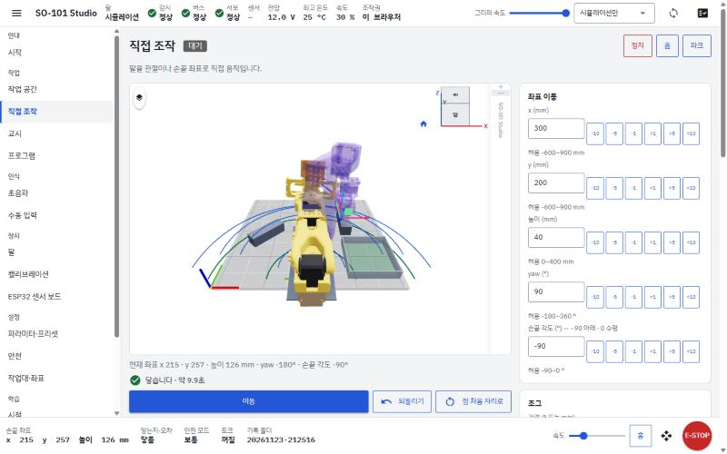

팔을 관절이나 손끝 좌표로 직접 움직인다.

| 조작 | 하는 일 |
|---|---|
| **3D에서 점 찍기** | 작업대를 클릭하거나 손잡이를 끌어 목표점을 고른다. 초록 호 = 집기 범위, 파란 호 = 고른 손끝 각도로 갈 수 있는 높이별 범위 |
| **좌표 이동** (x, y, 높이, yaw, 손끝 각도) | 숫자를 넣거나 ±1/5/10 버튼. 닿지 않으면 이유가 나온다. **[이동]** 으로 실행 |
| **[되돌리기]** (Ctrl+Z) | 목표 좌표를 바로 전 값으로(팔은 안 움직임) |
| **[점 처음 자리로]** | 목표점을 기본 위치로 |
| **조그** [관절 · 직교] | 간격 [누르기 · 1 · 5 · 10] (° 또는 mm). "누르기"는 누르는 동안만 움직인다 |
| **관절 각도 / [관절 이동]** | 관절 하나를 골라 각도를 넣고 이동 |
| **그리퍼** | 값(0~100) 또는 **폭(mm)** 을 넣고 **[폭으로]** |
| **집어 옮기기** | [집기] 점과 [놓기] 점(기본: 배출 구역)을 3D에서 찍고 **[집어 옮기기]** |
| **[홈] [파크] [정지]** (페이지 머리) | 홈 자세 / 접은 자세 / 멈춤 |

#### 교시
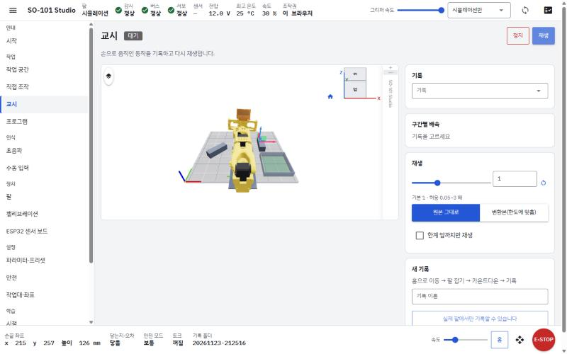

손으로 팔을 움직여 동작을 기록하고 다시 재생한다(기록은 실물 팔에서만).

| 조작 | 하는 일 |
|---|---|
| **기록** 고르기 | 저장한 동작(`config/sequences/`) |
| **구간별 배속** | 기록을 멈춤/느림/빠름 구간으로 나눠 구간마다 속도를 바꾼다 |
| **재생** 배속(0.05~3배), [원본 그대로 · 변환본(한도에 맞춤)] | 변환본은 속도·가속 한도 안으로 줄인 것 |
| **한계 앞까지만 재생** | 관절 한계에 닿기 전에 멈춘다 |
| **새 기록** | 이름을 넣고 시작 → 홈으로 이동 → 팔을 잡고 → 카운트다운 → 토크가 꺼지고 손으로 움직인 자세가 기록된다 → **[기록 끝내고 저장]** |

#### 프로그램
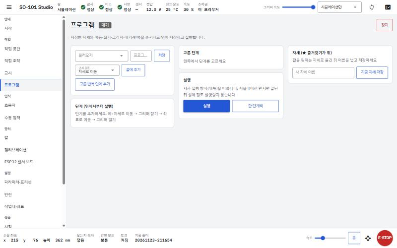

저장한 자세와 동작을 순서대로 엮어 저장하고 실행한다.
- **단계 종류 8개**: 자세로 이동, 좌표로 이동, 그리퍼, 집어 옮기기, 대기(0~600초), 홈, 교시 재생, 반복(1~1000회, 한 겹).
- 단계 종류를 고르고 **[끝에 추가]** 또는 **[고른 반복 안에 추가]**. 단계를 누르면 가운데 "고른 단계"에서 값을 고친다. 순서는 [위로]/[아래로].
- **[실행]**, **[한 단계씩]**(→ [다음 단계]), **[정지]**. 실행 중인 단계가 강조된다. 상단 실행 방식을 그대로 따른다.
- 오른쪽 **자세 목록**: 팔을 원하는 자세에 놓고 이름을 넣어 **[지금 자세 저장]**, ★ 즐겨찾기, [이동].
- 위쪽 **불러오기 / 이름 / [저장]** 으로 프로그램을 `config/programs/`에 저장한다.

### 인식
#### 초음파
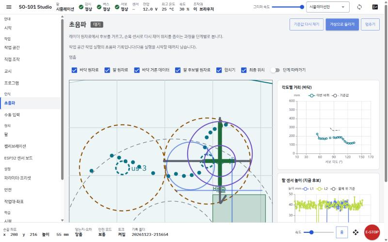

레이더 원자료에서 후보를 거르고, 손목 센서로 다시 재어 위치를 좁히는 과정을 단계별로 본다. 작업 공간에서 초음파로 실행한 기록이 다음 실행 전까지 남는다.
- **겹 체크**: 바닥 원자료 · 팔 원자료 · 바닥 거른 데이터 · 팔 후보별 원자료 · 합치기 · 최종 위치.
- **단계 따라가기**: 켜면 지금 단계에 맞춰 겹이 바뀐다.
- 오른쪽 그래프: **각도별 거리(바닥)** — 이번 바퀴 vs 기준값, **팔 센서 높이(지금 후보)**.
- 버튼: **[기준값 다시 재기]**(빈 작업대 기준), **[가상으로 돌리기]**, **[멈추기]**.

#### 수동 입력
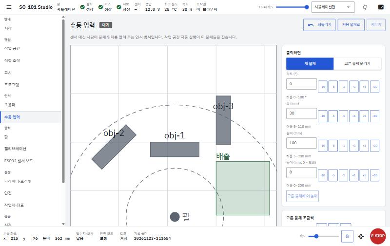

센서 대신 사람이 물체 위치를 알려 준다. 작업 공간 자동 실행이 이 물체들을 집는다.
- 평면을 클릭하면 **[새 물체]** 추가 또는 **[고른 물체 옮기기]**.
- 오른쪽에서 각도(0~180°), 폭(5~110mm), 길이(5~300mm), 높이(0 = 모름) 입력. **[고른 물체에 이 높이]**.
- **고른 물체 조금씩**: 화살표·회전 버튼으로 5mm·5°씩(길게 누르면 계속).
- 머리 버튼: **[되돌리기] [처음 물체로] [지우기]**.

### 장치
#### 팔
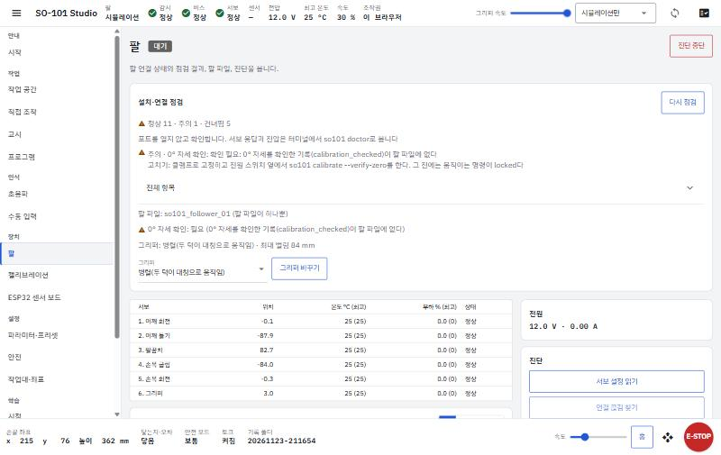

- **설치·연결 점검**: `doctor` 결과(정상/주의/건너뜀)와 고치는 방법. **[다시 점검]**.
- **팔 파일**과 그리퍼 종류. **[그리퍼 바꾸기]**(단동식 ↔ 병렬, 앱을 다시 켜야 적용).
- **서보 6개 표**: 위치, 온도, 부하, 상태. **전원**(전압·전류). 서보 건강 기준은 온도 50/60°C, 부하 70/90%, 전류 3/4A, 전압 11.5/11.0V(주의/오류).
- **진단**: [서보 설정 읽기], [연결 끊김 찾기], 전원·떨림 시험(큰 동작은 확인 창), **[진단 중단]**.

#### 캘리브레이션
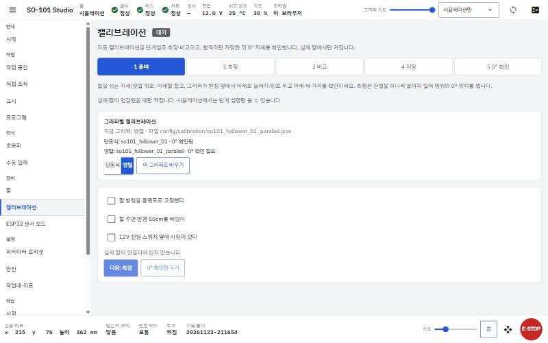

자동 캘리브레이션을 **1 준비 → 2 측정 → 3 비교 → 4 저장 → 5 0° 확인** 다섯 단계로 한다. **실물 팔에서만 켜진다**(시뮬레이션은 설명만).
1. **준비**: 체크 세 개(클램프 고정 · 반경 50cm 비움 · 전원 스위치 옆에 사람). 그리퍼별 캘리브레이션 파일도 여기서 고른다.
2. **측정**: 관절을 하나씩 끝까지 움직여 범위와 0° 위치를 잰다. 전압 11.0V 미만·온도 60°C 초과면 멈추고 되돌린다.
3. **비교**: 기존 파일과 ±3° 이내면 합격, 아니면 24시간 안 3회 측정이 서로 1° 이내일 때 합격.
4. **저장**: `yes`를 입력해야 서보·LeRobot 캐시·`config/calibration`에 쓴다(`.bak.json` 백업).
5. **0° 확인**: 속도 20%로 0° 자세에 가서 실물과 3D를 비교하고 **[맞음]**. 이 확인 전에는 움직이는 명령이 잠긴다.

#### ESP32 센서 보드
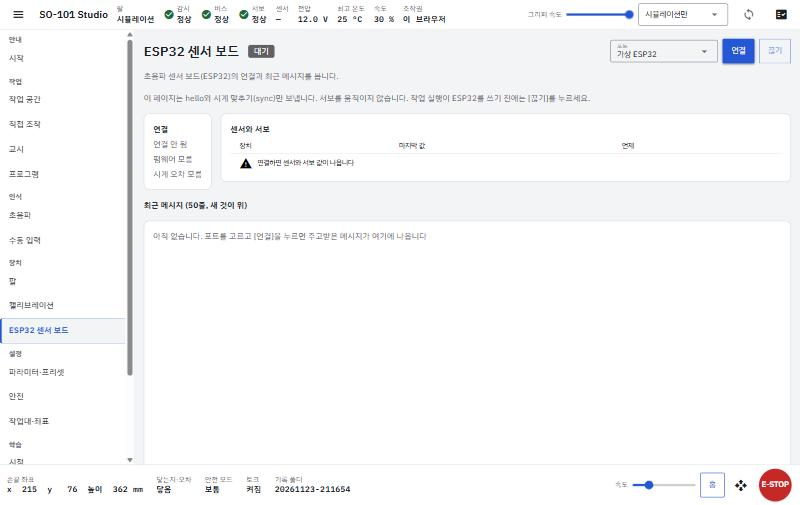

초음파 센서 보드의 연결과 최근 메시지를 본다. 포트(가상 ESP32 또는 COM 포트)를 고르고 **[연결] / [끊기]**. 연결 상태·펌웨어·시계 오차, 센서와 서보 값, 최근 메시지 50줄이 나온다. 이 페이지는 hello와 시계 맞추기만 보내고 서보를 움직이지 않는다.

### 설정
#### 파라미터·프리셋
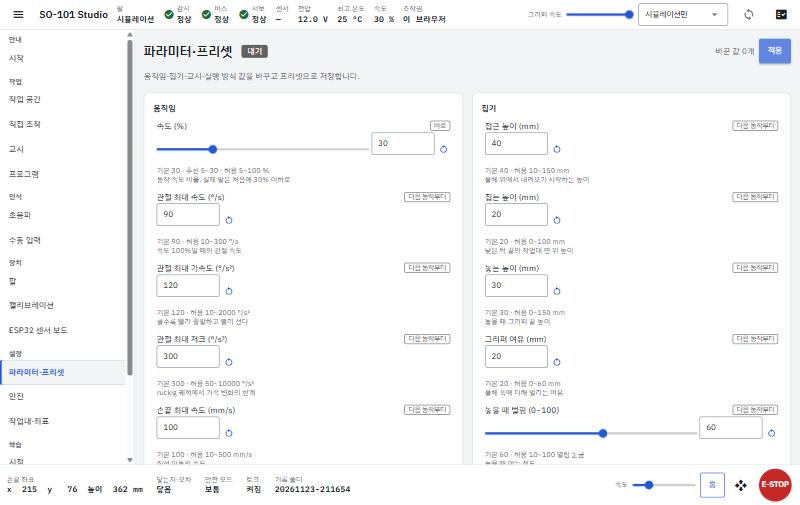

움직임·집기·교시·실행 방식 값을 바꾸고 프리셋으로 저장한다. 값마다 기본값·허용 범위·설명과 **적용 시점 배지**(바로 / 다음 동작부터)가 있고, ↺ 로 기본값에 돌린다. 바꾼 값 개수가 위에 나오고 **[적용]** 을 눌러야 반영된다.

#### 안전
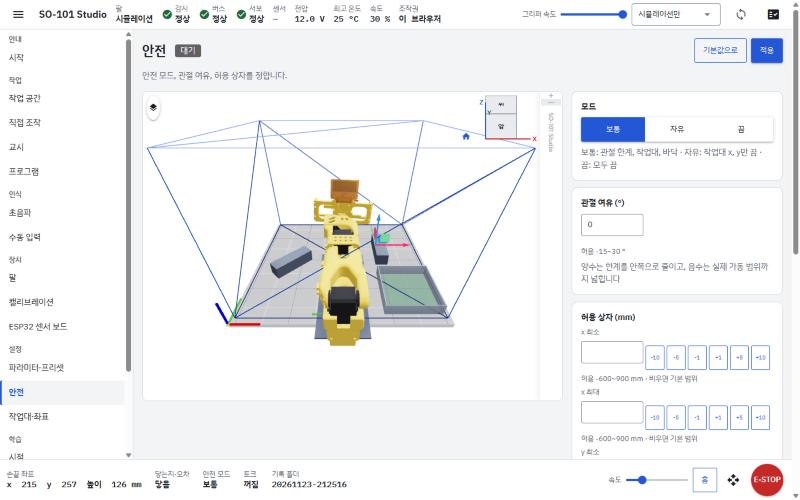

| 항목 | 내용 |
|---|---|
| **모드** [보통 · 자유 · 끔] | 보통: 관절 한계·작업대·바닥 검사 / 자유: 작업대 x·y만 끔 / 끔: 모두 끔(확인 창, 빨간 배지) |
| **관절 여유(°)** | 양수는 한계를 안쪽으로 줄이고, 음수는 실제 가동 범위까지 넓힌다 |
| **허용 상자(mm)** | x·y·z 최소/최대. 3D에 반투명 상자로 보인다. 비우면 기본 범위 |
| **[기본값으로] [적용]** | |

모드가 "끔"이어도 한 주기 이동량 한계와 과열·과부하 감시는 켜져 있다.

#### 작업대·좌표
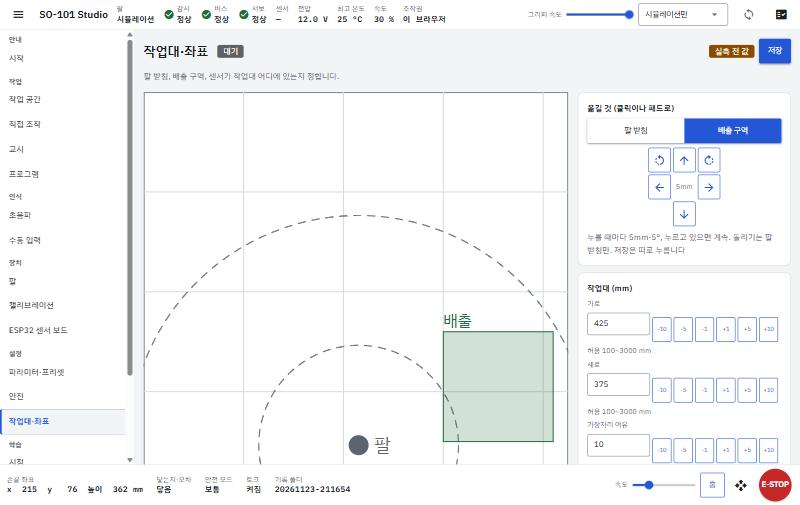

팔 받침, 배출 구역, 센서가 작업대 어디에 있는지 정한다. **옮길 것** [팔 받침 · 배출 구역]을 고르고 평면을 클릭하거나 패드(5mm·5°씩)로 옮긴다. 작업대 크기·가장자리 여유도 숫자로 넣는다. 실측 전 값에는 "실측 전 값" 배지가 붙는다. **[저장]** 하면 3D가 바로 바뀐다(`config/workspace.yaml`).

### 학습 (MuJoCo 시뮬레이션에서만)
#### 시점
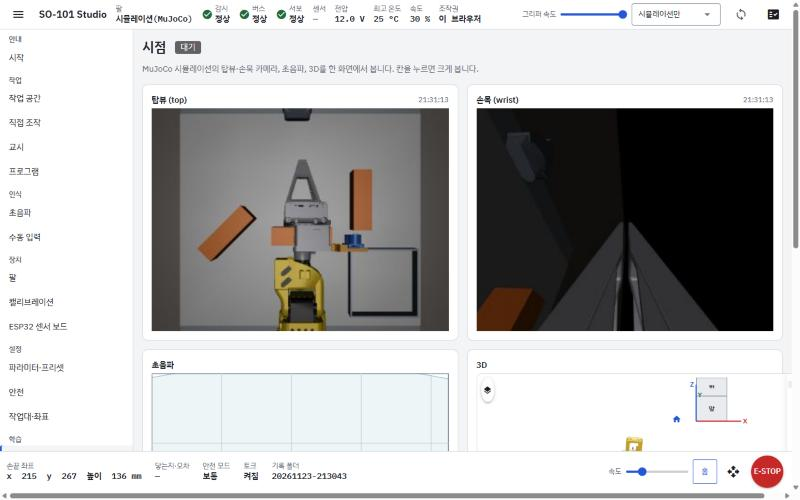

MuJoCo 시뮬레이션의 **탑뷰 카메라**, **손목 카메라**, 초음파, 3D를 2×2로 한 화면에서 본다. 칸을 누르면 크게, 다시 누르면 돌아온다.

#### 정책 실행
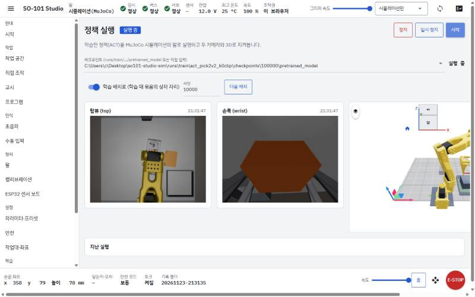

학습한 ACT 정책을 MuJoCo 팔로 실행하고 두 카메라와 3D로 지켜본다.
- **체크포인트**: `runs/train/…/pretrained_model` 목록에서 고르거나 직접 입력.
- **학습 배치로**(기본 켬) + **씨앗**: 학습 때와 같은 묶음의 상자 배치를 놓고 시작한다. **[다음 배치]** 는 씨앗을 1 올려 다시 놓는다.
- **[시작] [일시 정지] [정지]**. 끝나면 "성공 (배출 통에 놓음)" 같은 판정이 나온다(최대 45초).
- 학습 때 그리퍼와 지금 그리퍼가 다르면 시작하지 않고 안내한다.

### 시스템
#### 실행 기록
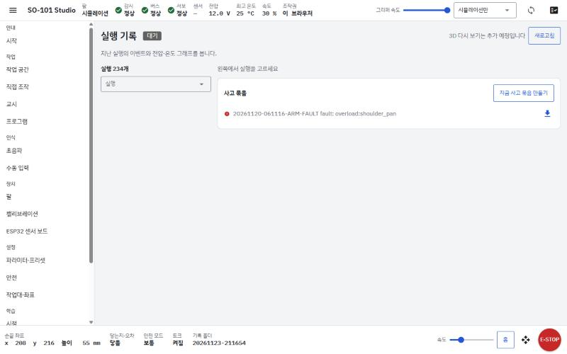

지난 실행(`runs/날짜-시각/`)을 골라 이벤트와 전압·온도 그래프를 본다. **사고 묶음**: 목록과 zip 내려받기, **[지금 사고 묶음 만들기]**.

#### 로그
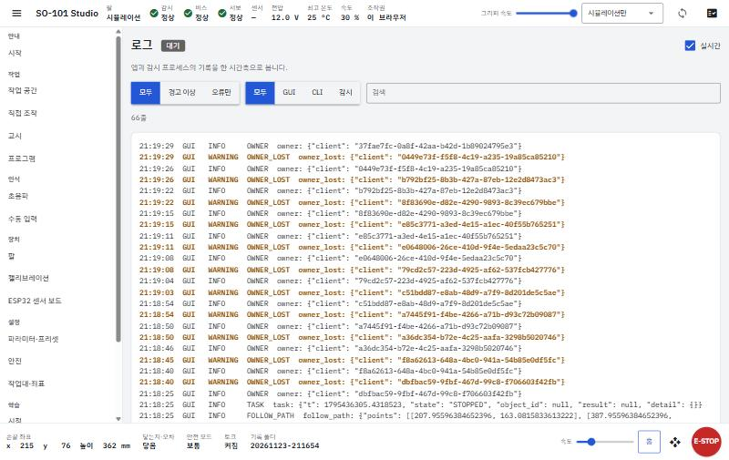

앱(GUI·CLI)과 감시 프로세스의 기록을 한 시간축으로 본다. 수준 [모두 · 경고 이상 · 오류만], 출처 [모두 · GUI · CLI · 감시], 검색, **실시간** 체크.

### 운영자 화면 (`/operator`)
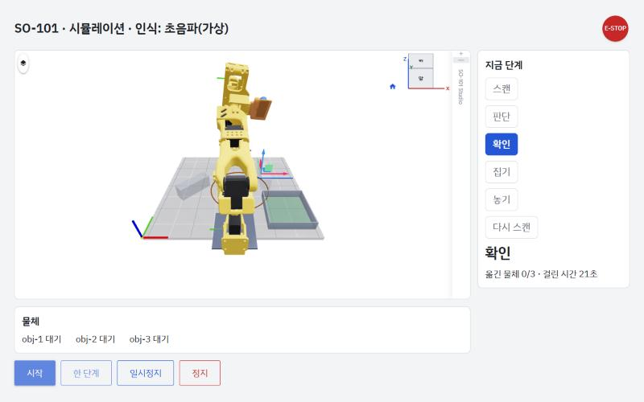

시연·프로젝터용 단순 화면. 시작 화면의 "운영자 화면 (시연용, 새 탭)"으로 연다. 큰 3D, **지금 단계**(스캔·판단·확인·집기·놓기·다시 스캔), 옮긴 물체 수와 걸린 시간, 물체 목록, **[시작] [한 단계] [일시정지] [정지]** 만 있다. 조작권이 없는 브라우저에서는 버튼이 숨고 E-STOP만 보인다.

---

## 6. 시뮬레이션 두 가지와 다른 기기에서 보기
| 실행 | 엔진 | 쓰는 곳 |
|---|---|---|
| `so101.cmd --sim gui` | 기구학 | 팔 없이 모든 기능. 빠르다 |
| `so101.cmd --sim --sim-engine mujoco gui` | MuJoCo 물리 | 턱이 물체를 치거나 미끄러지는 접촉, 카메라 두 개, 학습 페이지 |
| `so101.cmd gui --share` | (어느 것이든) | 같은 망의 다른 기기(폰·노트북)가 **보기 전용**으로 접속. 상단에 "공유 중" 배지와 주소 |

바탕화면 바로가기는 `so101.cmd gui`와 같다(팔이 없으면 기구학 시뮬레이션).

---

## 7. 명령줄
어느 폴더에서든 `so101.cmd [--sim] [--speed N] <명령>`. 모든 명령은 실행마다 `runs/날짜-시각/`에 `events.jsonl`·`status.jsonl`을 남긴다.

| 명령 | 하는 일 |
|---|---|
| `gui` | GUI 앱 |
| `doctor [--json]` | 읽기 전용 점검(환경·포트·캘리브레이션·서보 응답·전압·온도). 팔을 움직이지 않는다 |
| `find-port` | USB를 뽑아 사라진 포트로 팔 포트 찾기 |
| `status` · `home` · `park` · `movej` · `goto` · `gripper` | 상태 읽기와 기본 동작 |
| `pick x y 각도 폭 [높이]` · `place` | 집기·놓기(폭·높이 0이면 모름) |
| `run --source manual` | `config/manual_objects.yaml`의 물체를 가까운 순으로 집어 배출 구역으로 |
| `run --source ultrasonic [--us-port COMx]` | 초음파로 같은 작업 |
| `keys` | 키보드 조그: Tab으로 관절 / 직교 / 좌표 입력 모드 |
| `record <이름>` · `replay <이름>` · `info <이름>` | 교시 기록·재생·요약 |
| `calibrate --auto --measure-only` · `--save` · `--verify-zero` | 자동 캘리브레이션 |
| `powertest` · `shaketest` · `servoinfo` · `linkwatch` | 진단(팔을 크게 움직인다) |
| `incident` | 지금까지의 기록으로 사고 묶음 만들기 |

안전 옵션: `--free`(작업대 가장자리 끔), `--unsafe`(관절 한계·작업 영역·바닥 끔), `--safety-margin N`, `--box x0,x1,y0,y1,z0,z1`.

---

## 8. 안전 수칙
- 팔 받침은 **클램프로 고정**하고, 처음 움직일 때는 **속도 30% 이하**로 한다.
- **사람이 전원 스위치 옆**에서 지켜본다. 진단·캘리브레이션은 반경 50cm를 비운다.
- 멈출 때: 화면 **E-STOP**, 키보드 **F9**, 또는 12V 전원 스위치.
- 캘리브레이션 파일이 서보와 다르거나 0° 확인 기록이 없으면 **움직이는 명령이 잠긴다**(읽기만 된다). 점검 카드에 이유와 고치는 명령이 나온다.
- `keys`는 키 상태를 창과 상관없이 읽으므로, 실행 중 다른 창에 타이핑하지 않는다.

## 9. 실물 팔 연결
1. USB 시리얼 드라이버(CH340)를 설치한다: [`docs/guides/arm-hardware-setup.md`](docs/guides/arm-hardware-setup.md)
2. 팔 USB와 12V 전원을 꽂고 `so101.cmd doctor`로 포트·서보 응답·전압을 본다.
3. 이 PC에서 처음이면 `config/calibration/<팔>.json`을 `%USERPROFILE%\.cache\huggingface\lerobot\calibration\robots\so_follower\`에 복사한다(안 하면 "캘리브레이션 불일치"로 잠긴다).
4. 바로가기로 켜면 실물로 연결된다. 처음이면 캘리브레이션 페이지에서 **0° 확인**까지 한다.
5. 초음파 레이더는 조립 뒤 [`docs/guides/radar-bringup.md`](docs/guides/radar-bringup.md) 순서로 확인한다.

설정은 세 겹이다: `config/robot.yaml`(공통) ← `config/arms/<팔>.yaml`(팔별) ← `config/local.yaml`(PC별, git 제외, `local.example.yaml` 참고). 포트는 보드 시리얼로 자동으로 찾는다.

## 10. 하드웨어
| 부품 | 비고 |
|---|---|
| SO-101 팔 (STS3215 12V ×6) + 버스 서보 보드 | [TheRobotStudio/SO-ARM100](https://github.com/TheRobotStudio/SO-ARM100) |
| 병렬 그리퍼(기본) / 단동식(예비) | `config/grippers/` |
| ESP32-WROOM-32 + HC-SR04 ×2 (레이더용·손목용) | HC-SR04는 5V, ESP32는 3.3V: Echo 핀은 분압 저항이나 레벨 시프터를 거친다. 펌웨어 `firmware/esp32_scanner` |
| OpenRB-150 + Dynamixel XL330 | 레이더 회전. 펌웨어 `firmware/openrb_servo` |
| 작업대 425×375mm (40×80 프로파일 위), 배출 통 | 값은 `config/workspace.yaml` |

## 11. 구조와 폴더
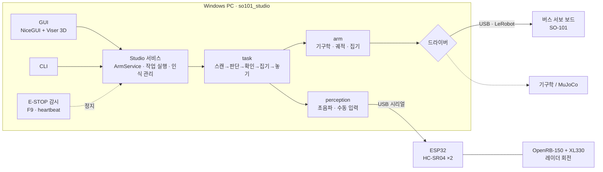
`arm`과 `perception`은 서로 모르고 `task`만 둘을 잇는다. 자세한 설계: [`docs/planning/system-architecture.md`](docs/planning/system-architecture.md)

```
src/so101_studio/   core · arm · perception · task · service · cli · gui · watchdog
config/             설정(robot · arms · grippers · workspace · scene · ultrasonic · sequences · programs)
firmware/           ESP32 스캐너, OpenRB 레이더 서보
assets/             SO-101·그리퍼·레이더 메시, MuJoCo 모델 (출처·라이선스 NOTICE)
tests/              pytest
docs/               설계 개요, 기능 명세, 비교 실험, 설치 가이드
```
개발자용: `conda activate so101` 뒤 `python -m pytest -q -m "not slow and not measure"`(빠른 묶음), 린트 `python -m ruff check src tests`. numpy는 conda 설치본이라 `pip`로 다시 설치하지 않는다.

## 12. 문제 해결
| 증상 | 확인할 것 |
|---|---|
| 브라우저가 안 열린다 | 주소창에 `http://127.0.0.1:8080`. 이전 GUI가 포트를 잡고 있으면 켤 때 알려 준다 |
| 팔이 있는데 시뮬레이션으로 켜진다 | USB·12V 전원을 꽂고 바로가기로 다시 켠다. `so101.cmd doctor`로 포트가 보이는지 |
| 버튼이 회색이고 "잠김" | 캘리브레이션 불일치 또는 0° 확인 전. 팔 페이지 점검 카드의 안내대로 |
| 다른 탭에서 버튼이 안 눌린다 | 보기 전용이다. 처음 연 탭이 조작권을 가진다 |
| "닿지 않습니다" | 집기 범위(3D 초록 호) 밖이거나 안전 검사에 걸림. 이유 문장을 본다 |
| 학습 페이지가 비어 있다 | MuJoCo 엔진으로 켰는지(`--sim --sim-engine mujoco`) |
| 실행이 갑자기 멈췄다 | 로그 페이지에서 경고 이상만 보기, 실행 기록의 사고 묶음 |

## 13. 알려진 한계
| 한계 | 지금 |
|---|---|
| 실물 초음파 미검증 | 위 숫자는 모두 시뮬레이션. 실물 레이더 조립 → 실측 → 보정이 다음 단계 |
| 손–몸 자기 접촉 검사 꺼짐 | 켜면 확인(CHECK) 성공률이 떨어져 기본은 끔. 실물 시험 전에 시뮬레이션에서 켜고 확인한다 |
| 이웃이 가까우면 위치 오차가 커짐 | 비관 모델 90% 약 22mm(목표 10mm). 시연 배치(간격 80mm 이상)는 10mm 안 |
| ACT는 규칙 기반보다 낮다 | 새 배치 74%, 규칙 기반 99.5% |
| 손목 센서 브래킷 재설계 중 | 센서 오프셋은 잠정값 |
| 카메라 인식 | 다음 단계(메뉴에 숨김) |

## 14. 감사와 라이선스
[LeRobot](https://github.com/huggingface/lerobot) · [SO-ARM100](https://github.com/TheRobotStudio/SO-ARM100) · [NiceGUI](https://nicegui.io) · [Viser](https://viser.studio) · [MuJoCo](https://mujoco.org). 가져온 메시·모델의 출처와 라이선스는 `assets/**/NOTICE.txt`, `assets/mujoco/so101/SOURCE.md`.

MIT License
